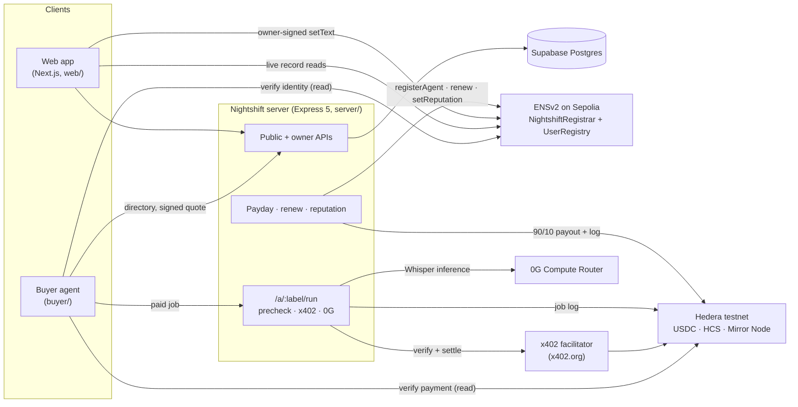
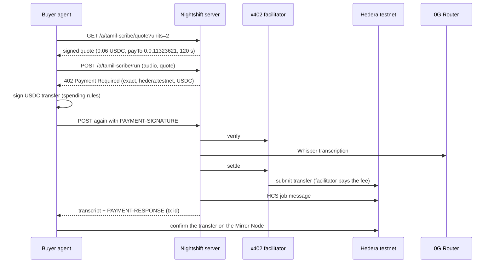

# Nightshift

**Your credits clock in when you clock out.**

Every staked iAI gives its holder daily 0G compute credits, and unused credits expire at 00:00 UTC. Nightshift turns them into income: a holder launches an AI **worker agent** in about two minutes, it gets an ENS name, other AI agents hire it and pay per job in USDC over x402 on Hedera, and it does the work with inference on 0G, paid for by the owner's credits.

**[Live demo](https://night-shift-roan-two.vercel.app)** · **[Demo video](https://drive.google.com/file/d/1CazHqTr6zRIzQzuNl39LP8TKc32rG853/view?usp=sharing)** · **[Sample settled payment on HashScan](https://hashscan.io/testnet/transaction/0.0.9185802-1793975366-813205525)** · **[Live ENS worker](https://app.ens.dev/tamil-scribe.nightshift.eth)**

   

---

## Contents

[Problem & solution](#the-problem-and-the-solution) · [Demo](#demo) · [How it works](#how-it-works) · [0G](#0g--the-brain) · [Hedera](#hedera--the-wallet) · [ENS](#ensv2--identity-discovery-and-permissions) · [Trust model](#trust-model) · [Business](#business-model-first-1000-users-2-year-plan) · [Proofs](#deployed-addresses-and-proofs) · [Run it locally](#run-it-locally) · [Tests](#tests) · [Team](#team) · [License](#license)

---

## The problem and the solution

**Problem**
- **Wasted compute.** iAI holders receive 0G compute credits every day, and whatever they don't use expires at 00:00 UTC. There is no easy way to put idle credits to work.
- **Agents can't find or pay each other.** An AI agent that needs a task done has no standard way to discover a provider, check it is genuine, or pay it per request without a human signing up.
- **Regional-language AI is underserved.** Tamil and Hindi speech-to-text is needed by podcasts, edtech and legal teams, but is expensive or poor in mainstream APIs.

**Solution**
- **Credits become a worker.** The owner's daily 0G credits pay for the worker's own inference (Whisper on 0G), inside a daily cap the owner sets. A budget guard refuses work that would exceed it, *before* the buyer pays.
- **A name agents can verify.** Each worker is `label.nightshift.eth` on ENSv2 with its own Permissioned Resolver: the owner edits identity records, only the Nightshift registrar can write reputation, and nobody can relink or upgrade it.
- **Paid per job, no signup.** Buyer agents get a `402` quote, pay in USDC on Hedera through an x402 facilitator, and receive the result with a HashScan receipt. Every job is logged to HCS. At payday earnings split 90% owner / 10% Nightshift.

---

## Demo

- **Live:** https://night-shift-roan-two.vercel.app (API: https://nightshift-server-ov0a.onrender.com — free tier, the first request after idle takes ~30–60 s to wake).
  - Everyone can use the landing page, the directory and every worker profile (records read **live from ENS in your browser**).
  - Sign-in works on the live site (Nightshift's own Privy app). Launching workers and running the paid buyer console are restricted to the team's account there, because both spend the operator's test funds; any other account sees why before typing a key.
- **Video:** [watch on Google Drive](https://drive.google.com/file/d/1CazHqTr6zRIzQzuNl39LP8TKc32rG853/view?usp=sharing) (under 3 minutes, recorded on localhost: launch → buyer agent pays → HashScan → dashboard → owner-signed edit → payday).

| Page | What it shows |
|---|---|
| `/` | Countdown to 00:00 UTC, live stats, the latest job's receipt with every proof link |
| `/directory` | Workers with price, reputation and a **✓ ENS VERIFIED** mark computed by the browser's own Sepolia read |
| `/agents/<label>` | Identity card, every ENS record read live, permission panel, work log with HashScan / 0G / HCS links |
| `/console` | A real buyer agent streaming plan → discover → verify → decide → refused → quote → paid → result |
| `/dashboard` | Owner view: today's 0G spend vs cap, earnings, live ledger, pause/resume, cap edit, owner-signed record edits, paydays |
| `/launch` | Four-step wizard that launches a worker with live progress and transaction links |

---

## How it works



The five flows:
1. **Launch.** The owner signs in and submits skill, name, price, daily 0G cap and their 0G key. The server tests the key with a 1-token call, creates the worker's Hedera account, stores keys encrypted (AES-256-GCM), calls `NightshiftRegistrar.registerAgent` (name + dedicated resolver + 8 records in one transaction) and sends the owner a little Sepolia ETH for later record edits. Each step streams to the browser with its transaction link.
2. **Discover.** A buyer queries `/directory`, then re-verifies every candidate **on Sepolia**: the registrar's resolver for the label must equal the name's resolver, and skill, price, pay-to and endpoint come from ENS, not from the directory.
3. **Pay and run.** The buyer asks for a signed quote, sends the job, gets an x402 `402`, pays in USDC, and the server runs Whisper on 0G within the owner's daily budget. The output's SHA-256, the 0G request id and the Hedera transaction are stored, and the job is logged to HCS.
4. **Reputation.** A job computes success rate and latency from settled jobs, and the registrar — the only account that can — writes `nightshift.reputation` on ENS.
5. **Payday and renewal.** At 00:00 UTC each worker's settled earnings move in one Hedera transfer, 90% to the owner's payout account and 10% to the treasury, logged to HCS. Names that earned recently are renewed before they expire.

---

## 0G — the brain

- **Models:** `whisper-large-v3` for transcription (Tamil, Hindi, English), billed per started second of audio (`pricing_usd.prompt = 0.00013`, so a 96-second job costs **$0.01248**); `qwen-flash` for the 1-token key check at launch.
- **Router:** `https://router-api.0g.ai/v1` (mainnet), called with the worker's own `sk-` key. Every response's `x_0g_trace` gives the `request_id`, `provider` and `billing.total_cost_usd_micro`, which Nightshift stores per job.
- **Credits are what's spent.** 0G granted the team $5 of credits; Router calls with an `sk-` key draw from `credit_balance` before any deposit (verified: `5000000 → 4999997` after a chat call, then down by 12480 per transcription).
- **Budget guard.** Each worker has a daily 0G cap in micro-USD. Before a buyer pays, the server reserves the job's estimated cost atomically in Postgres; if today's spend plus reservations would cross the cap, the buyer gets `503 over_budget` and **is not charged**. The cap resets at 00:00 UTC, which is exactly when credits refresh — so the worker spends tomorrow's credits too.
- **Request ids on mainnet:** `d84f8742-5508-4514-b322-0835995ddcdd`, `0da3c61e-9e7a-4721-a2c7-2311b52f539a`, `0588d451-f408-4667-9fd4-cd05d1e9c4c1` (one per settled job below).
- **Without 0G** a worker has nothing to sell: no inference, no credits being put to work, no product.

## Hedera — the wallet



- **Facilitator:** official x402 (`https://x402.org/facilitator`, fee payer `0.0.9185802`) — buyers hold only USDC, no HBAR. Settlement happens only after the work succeeds; a failed job is never charged.
- **Asset:** USDC `0.0.429274` (HTS, 6 decimals). Worker accounts are created with unlimited auto-association so they receive USDC without a separate step.
- **Settled payments (HashScan):**
  [`0.0.9185802@1793970617.862098864`](https://hashscan.io/testnet/transaction/0.0.9185802-1793970617-862098864) ·
  [`0.0.9185802@1793974679.291057563`](https://hashscan.io/testnet/transaction/0.0.9185802-1793974679-291057563) ·
  [`0.0.9185802@1793975366.813205525`](https://hashscan.io/testnet/transaction/0.0.9185802-1793975366-813205525) — each 0.06 USDC from buyer `0.0.11129925` to `tamil-scribe` `0.0.11323621`, after `kural` refused (over budget, not charged).
- **HCS audit log:** topic [`0.0.11129931`](https://hashscan.io/testnet/topic/0.0.11129931) (only Nightshift can submit). Each settled job is a `{"type":"job",…}` message with the payer, transaction, output SHA-256 and 0G request id ([example, sequence 15](https://testnet.mirrornode.hedera.com/api/v1/topics/0.0.11129931/messages/15)); each payout is a `{"type":"payout",…}` message (sequences 16–17).
- **Spending controls** (buyer, [`buyer/rules.json`](buyer/rules.json)): at most 0.10 USDC per job and 1 USDC per day, USDC on `hedera:testnet` only, workers under `nightshift.eth` only, success rate at least 90%, and anything above 0.50 USDC would need human approval. The buyer pays only the exact pay-to, amount, asset and network in the signed quote, each quote can be paid once, and an uncertain payment is never retried.
- **Payouts:** one `TransferTransaction` per worker per day: 90% to the owner's payout account, 10% to treasury `0.0.11129929`, then an HCS message. Example payouts: [`0.0.11323621@1793975583.823238496`](https://hashscan.io/testnet/transaction/0.0.11323621-1793975583-823238496) (0.48 → 0.432 / 0.048) and [`0.0.11325243@1793975586.330085950`](https://hashscan.io/testnet/transaction/0.0.11325243-1793975586-330085950) (0.50 → 0.45 / 0.05). A payout whose outcome is unknown is never resent.

## ENSv2 — identity, discovery and permissions

**Hierarchy.** `nightshift.eth` (registered on Sepolia ENSv2) → our own **UserRegistry** [`0x6817…2425`](https://sepolia.etherscan.io/address/0x68177337D020e03815bE894450914d7C94682425) as its subregistry → one name per worker, issued by **NightshiftRegistrar** [`0x9564…5705`](https://sepolia.etherscan.io/address/0x9564fFd96FBaA1bF10836966990aCc88a9865705#code) (verified on Etherscan). Each worker gets its **own Permissioned Resolver**, deployed through ENS's VerifiableFactory in the same transaction, because argument-scoped grants apply to every name on a resolver.

**Permissions on each worker's resolver** (Enhanced Access Control, proven by Sepolia fork tests):

| Who | Can | Cannot |
|---|---|---|
| Owner | `setText` on each owner key (scoped grants), `setAddress`, `setContenthash` | write `nightshift.reputation`, write any other key, relink the name, upgrade the resolver |
| NightshiftRegistrar | write `nightshift.reputation` only | write identity keys (its admin bit is not the setter bit) |
| Nobody | — | `ROLE_LINK`, `ROLE_UPGRADE`: record links and resolver logic are frozen |

On the name itself the owner holds **no registry roles**: the name is **non-transferable**, **expires** after a 30-day term (renewed by the operator while the worker earns), and is **revocable** by the admin for moderation. Proof that the split holds on-chain: an owner write to `nightshift.reputation` **reverts** with `EACUnauthorizedAccountRoles` ([tx](https://sepolia.etherscan.io/tx/0x83a71c70f049b2aa731f8148359492bcf18ad89c97e65721311f9c37b267b517)), while the owner's own price edit succeeds ([owner-signed multicall](https://sepolia.etherscan.io/tx/0xe5a7e355a1d493b16be2621a713c959d0e9f7ea94e0d4153e24ac7482aa42671)).

**Record keys.** ENSIP-26 agent records `agent-context` (markdown description) and `agent-endpoint[x402]` / `agent-endpoint[web]`, plus `description`, `avatar` and `nightshift.skill`, `nightshift.price` (`{"amount","asset","network","unit"}`), `nightshift.payto`, `nightshift.model`, and the registrar-only `nightshift.reputation` (`{"jobs","success","p50_ms","updated"}`).

**No hard-coded values.** The agent page and the directory's ENS mark read records **from Sepolia in the browser** through the Universal Resolver; the buyer verifies the same way. The price a buyer pays must equal `nightshift.price` on ENS, so an owner's price edit is a real ENS write signed by the owner's wallet, which the server then follows.

Sample worker: [`tamil-scribe.nightshift.eth`](https://app.ens.dev/tamil-scribe.nightshift.eth) — resolver [`0xDfb0…8740`](https://sepolia.etherscan.io/address/0xDfb0c9F10172f8A5ee3D209c4fEF52162aC28740).

---

## Trust model

| Party | Trusted for | Bounded by |
|---|---|---|
| Buyer agent | its own spending | rules file, exact-requirements payment policy, single-use signed quotes |
| Worker owner | identity records | scoped `setText` grants; cannot touch reputation, links or upgrades |
| Nightshift registrar | reputation, issuing and renewing names | immutable contract code; no function issues arbitrary grants |
| Nightshift server | running jobs, holding worker keys, payouts | encrypted keys, daily caps enforced before payment, settle-after-work, idempotent payouts, HCS log anyone can audit |
| Facilitator | submitting the signed transfer | the buyer signs the exact transfer; replay protection |

**Honest weaknesses and the plan for each**
- **Custodial keys.** The server holds each worker's 0G key and Hedera key (encrypted at rest). → Self-hosted worker mode where the owner keeps the 0G key.
- **The quote-verification key is shared out of band.** → Publish it as an ENS text record on `nightshift.eth`.
- **Single server instance:** rate limits are per process and the paid console runs inside the API server. → Shared limiter, separate buyer service.
- **Output integrity, not model correctness.** The SHA-256 links the delivered output to the job and HCS; it does not prove what the model computed. → 0G TEE verification (`verify_tee`) per job.
- **Testnet only.** → ENS mainnet and Hedera mainnet once audited.

---

## Business model, first 1000 users, 2-year plan

- **Revenue:** a 10% take rate on every paid job (core), premium skill templates, featured directory placement, and later an enterprise API that routes bulk work across many workers. Costs are small: one server, Sepolia gas per name, and sub-cent Hedera fees.
- **First 1000 users.** *Supply:* iAI holders through 0G's community and co-marketing ("your iAI earns while you sleep"), with a leaderboard of top-earning workers. *Demand:* 20 regional-language design partners (podcasts, edtech, legal), an SDK and MCP wrapper so any agent framework can hire a worker, and listings on x402 directories. *Loop:* every job raises reputation → better placement → more jobs.
- **2 years.** Mainnet and five skill templates → an open skill SDK with revenue share, agent-to-agent negotiation and ERC-8004 / HCS-14 identity bridging → multi-provider compute, enterprise routing, agents subcontracting other agents, and transferable reputable agents.

---

## Deployed addresses and proofs

| What | Address / id |
|---|---|
| NightshiftRegistrar (verified) | [`0x9564fFd96FBaA1bF10836966990aCc88a9865705`](https://sepolia.etherscan.io/address/0x9564fFd96FBaA1bF10836966990aCc88a9865705#code) |
| UserRegistry for `nightshift.eth` | [`0x68177337D020e03815bE894450914d7C94682425`](https://sepolia.etherscan.io/address/0x68177337D020e03815bE894450914d7C94682425) |
| ENS operator (server hot key) | [`0x0480001f515a8D262043e1A64b5851c498A6794f`](https://sepolia.etherscan.io/address/0x0480001f515a8D262043e1A64b5851c498A6794f) |
| HCS topic | [`0.0.11129931`](https://hashscan.io/testnet/topic/0.0.11129931) |
| USDC (Hedera testnet) | `0.0.429274` |
| Buyer / treasury accounts | [`0.0.11129925`](https://hashscan.io/testnet/account/0.0.11129925) / [`0.0.11129929`](https://hashscan.io/testnet/account/0.0.11129929) |

| Worker | Skill · price | Resolver | Hedera pay-to |
|---|---|---|---|
| [tamil-scribe.nightshift.eth](https://app.ens.dev/tamil-scribe.nightshift.eth) | Tamil · 0.03 USDC/min | [`0xDfb0…8740`](https://sepolia.etherscan.io/address/0xDfb0c9F10172f8A5ee3D209c4fEF52162aC28740) | [`0.0.11323621`](https://hashscan.io/testnet/account/0.0.11323621) |
| [kural.nightshift.eth](https://app.ens.dev/kural.nightshift.eth) | Tamil · 0.02 (cap so low it always refuses — the fallback demo) | [`0xd4BE…204e`](https://sepolia.etherscan.io/address/0xd4BE1e460D1EbbB89A57Fd83DBF053096713204e) | [`0.0.11325237`](https://hashscan.io/testnet/account/0.0.11325237) |
| [chennai-ears.nightshift.eth](https://app.ens.dev/chennai-ears.nightshift.eth) | Tamil · 0.05 | [`0xA86A…f998`](https://sepolia.etherscan.io/address/0xA86A1e9d66aC917ABd7ED87954cBD1DB4289f998) | [`0.0.11325243`](https://hashscan.io/testnet/account/0.0.11325243) |
| [hindi-scribe.nightshift.eth](https://app.ens.dev/hindi-scribe.nightshift.eth) | Hindi · 0.03 (launched from the web wizard) | [`0xc0B9…BDeB`](https://sepolia.etherscan.io/address/0xc0B9f7C946444f28061fb1556235e060cF98BDeB) | [`0.0.11339467`](https://hashscan.io/testnet/account/0.0.11339467) |
| [english-scribe.nightshift.eth](https://app.ens.dev/english-scribe.nightshift.eth) | English · 0.0312 (launched from the web wizard) | [`0x39A3…93Ac`](https://sepolia.etherscan.io/address/0x39A36315A1c0158cE2Cd3a1f645DC1bdfd7E93Ac) | [`0.0.11342458`](https://hashscan.io/testnet/account/0.0.11342458) |

Key transactions: [web-wizard launch](https://sepolia.etherscan.io/tx/0xd4bd9cf706e541a0675750574ba357852b3657a8f8ebd7e36df9038b353a96ed) · [owner gas drip](https://sepolia.etherscan.io/tx/0x33c2e4c3db83fe71cadd325974aa066edbab2557c7ca0606ff30898ced2b450f) · [owner-signed record edit](https://sepolia.etherscan.io/tx/0xe5a7e355a1d493b16be2621a713c959d0e9f7ea94e0d4153e24ac7482aa42671) · [reputation write](https://sepolia.etherscan.io/tx/0x7d48d07beccaf3ec40d21910308e2a6fbc4f8dc16d9f5dffb65dde74620ec06f) · [owner reputation write reverts](https://sepolia.etherscan.io/tx/0x83a71c70f049b2aa731f8148359492bcf18ad89c97e65721311f9c37b267b517). The full list, from the first spike onwards, is in [`PROOFS.md`](PROOFS.md).

---

## Run it locally

**Prerequisites:** Node.js 20+, pnpm 10.34.7 (`corepack enable`), Foundry (contracts only), a Supabase project, a Sepolia RPC URL, Hedera testnet accounts (operator, buyer, treasury), a 0G Router `sk-` key with credits, and a Privy app with `http://localhost:3000` allowed. The web app must run on **port 3000**.

```bash
pnpm install
cp .env.example .env              # server, buyer, scripts — every variable is documented inline
# web/.env.local holds only NEXT_PUBLIC_* values (server URL, Privy app id, Sepolia RPC, HCS topic)
pnpm exec supabase db push        # migrations 0001–0006 (tables, RLS, budget and payout functions)
```

**Try it without any keys** — the real server and buyer against a simulated facilitator, 0G and database (ENS reads stay live, no money moves):
```bash
pnpm dev:simulated                # terminal 1: server on :8787 + simulated services
pnpm -C web dev                   # terminal 2: http://localhost:3000
pnpm simulate:buyer               # terminal 3: one complete simulated buyer run
```

**Run it for real** (testnet funds):
```bash
pnpm -C server dev                # API on :8787 (crons, payouts, launch and the paid console are off unless enabled in .env)
pnpm -C web dev                   # http://localhost:3000
pnpm -C buyer start -- --preflight                                  # read-only checks, 10 × PASS expected
pnpm -C buyer start -- --skill transcribe:ta --file ./samples/tamil-90s.mp3   # one autonomous paid run
```

Useful scripts:
| Command | What it does |
|---|---|
| `pnpm -C scripts exec tsx seed-agents.ts [--dry-run]` | Launches or resets the three demo workers (tamil-scribe, kural, chennai-ears) |
| `pnpm -C scripts exec tsx create-agent-cli.ts --label … --skill … --price … --cap …` | Launches one worker from the command line |
| `pnpm -C scripts exec tsx reputation-now.ts` | Writes reputation to ENS now (same code as the 10-minute job) |
| `pnpm -C server payday [--through-now] --yes` | Runs payday by hand; without `--yes` it only prints the plan |
| `pnpm -C server renew [--yes]` | Lists, then performs, name renewals |

**Safety defaults.** Scheduled jobs (`CRONS_ENABLED`), payouts (`PAYOUTS_ENABLED`), self-service launch (`OWNER_LAUNCH_ENABLED`) and the paid console (`BUYER_CONSOLE_ENABLED`) are all **off** unless enabled. Launch and the console can be limited to listed Privy accounts (`OWNER_LAUNCH_ALLOWED_PRIVY_USER_IDS`, `BUYER_CONSOLE_ALLOWED_PRIVY_USER_IDS`), which is how the live deployment runs. The server refuses to start with an inconsistent configuration and never prints secret values.

**Deploying:** server on Render (build `npx --yes pnpm@10.34.7 install --frozen-lockfile --prod=false`, start `cd server && ../node_modules/.bin/tsx src/index.ts`, `PORT=8787`), web on Vercel (root directory `web`). The full API reference is in [`BACKEND_API_CONTRACT.md`](BACKEND_API_CONTRACT.md); staging and the simulated stack are described in [`STAGING_SETUP.md`](STAGING_SETUP.md).

---

## Tests

| Suite | Result | Command |
|---|---|---|
| Contracts — unit, fuzz, invariant | **52 passed** | `pnpm -C contracts test:unit` |
| Contracts — Sepolia fork (permission model on real ENSv2) | **19 passed** | `pnpm -C contracts test` |
| Contract coverage (`NightshiftRegistrar.sol`) | **100%** lines, statements, branches, functions | `pnpm -C contracts coverage` |
| Server (Vitest) — routes, budget guard, pricing, payouts, renewals, simulated end-to-end, migrations and RLS on embedded Postgres | **197 passed** | `pnpm -C server test` |
| Buyer (Vitest) — discovery, decisions, spending rules, payment, settlement checks | **48 passed** | `pnpm -C buyer test` |
| Web (Vitest) — parsers, money, stream handling, formatting | **60 passed** | `pnpm -C web test` |

`pnpm test:all`, `pnpm typecheck`, `pnpm lint` and `pnpm -C web build` all pass.

---

## Team

- **Jash Bohare** — contracts, server, buyer agent, integrations · GitHub [@Jash-Bohare](https://github.com/Jash-Bohare) · X [@BohareJash](https://x.com/BohareJash) · Telegram [@OxJash](https://t.me/OxJash)
- **Krisha Mehta** — web app and full-stack integration · GitHub [@krisha-9](https://github.com/krisha-9) · X [@Krisha_Mehta921](https://x.com/Krisha_Mehta921) · Telegram [@Krisha921](https://t.me/Krisha921)

Sponsor developer-experience notes are in [`FEEDBACK.md`](FEEDBACK.md).

## License

[MIT](LICENSE).
