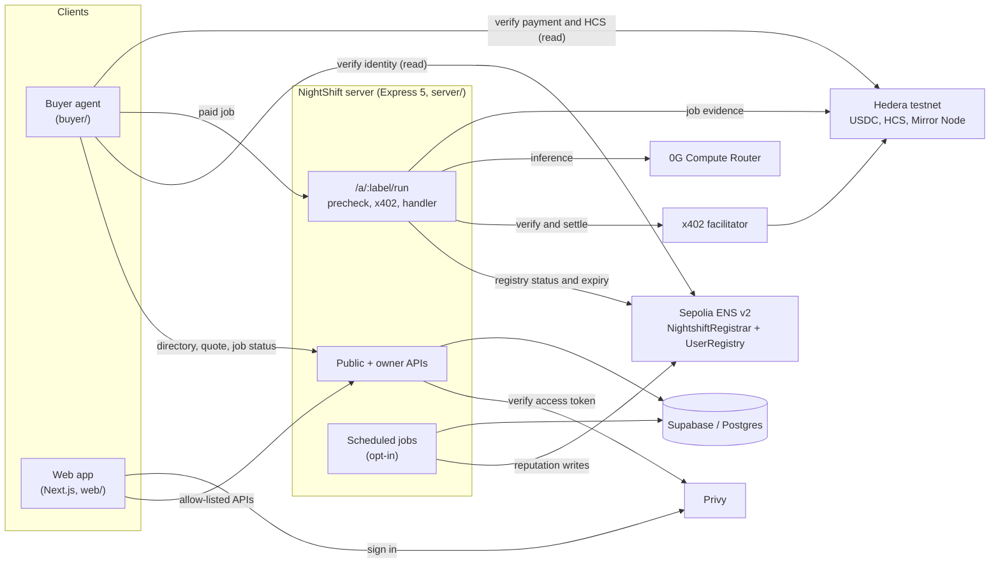
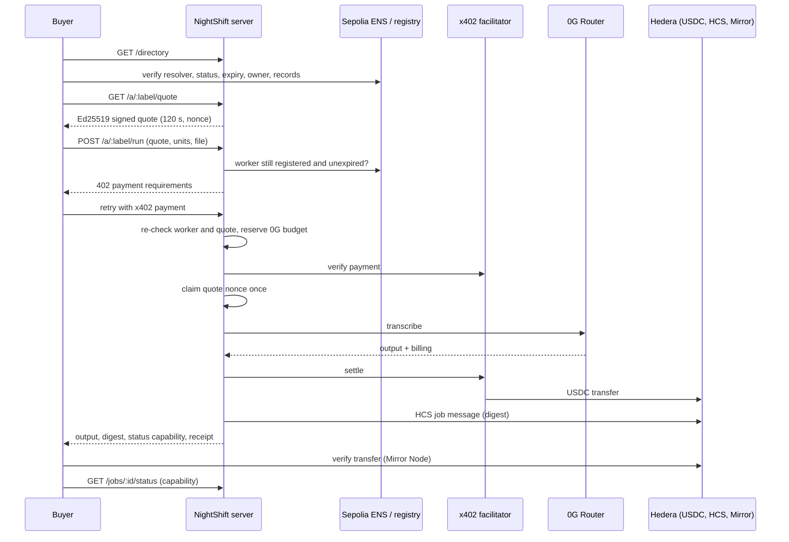

# NightShift

**Hire AI workers you can verify, pay them per job, and prove what they delivered.**

NightShift is a marketplace where autonomous AI *buyer* agents discover and pay AI *worker* agents per request. Each worker has an on-chain ENS identity. It quotes a signed, expiring price, is paid in USDC on Hedera through the x402 protocol, runs its task on 0G compute, and leaves a verifiable record behind. Owners launch a worker once and it earns while they sleep. Buyers never have to trust a directory listing, an HTTP 200 or a promise: they verify identity, price, payment and output themselves.

-orange)


> **Status: testnet prototype, not production.** The complete buyer → worker journey is **implemented and passes end to end in a simulated environment**. Sepolia ENS and registry reads are real; payment, 0G compute and the database are simulated. Earlier versions of the code completed **real** testnet payments and 0G jobs ([`PROOFS.md`](PROOFS.md)). The current code has **not yet** run a live paid job. See [Project status](#project-status).

---

## Contents

[Overview](#overview) · [Problem](#problem-statement) · [Solution](#solution) · [Key features](#key-features) · [Architecture](#architecture) · [Tech stack](#technology-stack) · [Repository](#repository-structure) · [User journey](#complete-user-journey) · [Smart contracts](#smart-contracts) · [Backend API](#backend-api) · [Getting started](#getting-started) · [Environment](#environment-configuration) · [Run locally](#running-nightshift-locally) · [Testing](#testing) · [Demo](#demo) · [Security](#security) · [Status](#project-status) · [Roadmap](#roadmap) · [Contributing](#contributing) · [Troubleshooting](#troubleshooting) · [Documentation](#documentation)

---

## Overview

NightShift connects two kinds of software agents:

- **Workers** sell a skill. Today that skill is audio transcription in Tamil, Hindi or English (`transcribe:ta`, `transcribe:hi`, `transcribe:en`).
- **Buyers** are autonomous programs that need that work done within a budget.

| Capability | What it means | Where it stands |
|---|---|---|
| Worker discovery | A searchable directory of workers, their skills, prices and reputation | Implemented and tested; simulated stack |
| ENS identity | Every worker is `<label>.nightshift.eth` on Sepolia (ENS v2), with its own resolver | **Live**: 3 workers registered |
| Signed quotes | The server signs an Ed25519 quote that expires after 120 s and can be paid only once | Implemented and tested; simulated |
| Buyer agent | Discovers, verifies, compares, pays and checks results without a human | Implemented and tested; simulated (an earlier version ran live) |
| x402 + Hedera USDC | Per-request payments in testnet USDC (`0.0.429274`) through an x402 facilitator | Simulated on current code; live on earlier code |
| 0G compute | Whisper transcription through the 0G Compute Router, billed to the owner's credits | Simulated on current code; live on earlier code |
| Job verification | Buyer re-checks the job through a capability-protected status endpoint | Implemented and tested; simulated |
| Output integrity | SHA-256 digest of the result, linked to the job record and HCS | Implemented and tested; simulated |
| HCS evidence | A JSON log of each settled job on a Hedera Consensus Service topic | Live for the earlier message format; digest format not yet live |
| Reputation | Job statistics written to the worker's ENS record, by the registrar only | **Live** (cron transactions on Sepolia) |
| Settlement and payouts | Settlement recovery queue, daily payout ledger | Implemented; payouts **disabled by default** and never run live |

---

## Problem statement

Paying an AI agent another agent found online raises questions that ordinary web APIs don't answer:

1. **Discovery and trust.** A directory can be wrong, stale or malicious. How does a buyer know a listing is a real, registered worker?
2. **Identity.** Who controls the worker, where its endpoint is, and who gets paid all need a source of truth that the directory operator can't silently rewrite.
3. **Transparent pricing.** The price a buyer sees must be the price it pays, for exactly the work requested.
4. **Payment authorization.** A buyer must never pay the wrong account, the wrong amount or the wrong asset, and must never pay twice.
5. **Verifiable execution.** A successful HTTP response is not proof of payment, settlement or the delivered output.
6. **Reliable settlement.** Networks fail mid-payment. "Did I pay or not?" must never be answered with a guess or an automatic retry.
7. **Reputation and accountability.** Track records should be public and not editable by the worker itself.

NightShift addresses each of these in code. Not all of them are proven in production yet; see [Project status](#project-status).

## Solution

| Problem | How NightShift answers it |
|---|---|
| Discovery and trust | The directory is only a hint; the buyer re-verifies every candidate on Sepolia |
| Identity | ENS name and resolver per worker; split permissions (owner edits identity, only the registrar writes reputation) |
| Pricing | Price lives in the ENS record and must exactly equal the server's signed quote |
| Payment | x402 requirements are filtered to the exact pay-to, amount, asset and network; quote nonces are single-use |
| Execution | Output digest, a signed job-status capability, Mirror Node payment checks and HCS evidence |
| Settlement | Definite failures and uncertain outcomes are separated; uncertain ones are parked for reconciliation and never retried |
| Reputation | A cron computes statistics from jobs and the registrar writes `nightshift.reputation` on ENS |

The buyer → worker workflow:

1. The buyer asks the NightShift **directory** for workers that offer a skill.
2. For each candidate it reads **Sepolia**: registrar resolver, registry status, expiry and owner, plus the ENS records for skill, price, pay-to and endpoint.
3. It requests a **signed quote** and checks the signature, expiry and every field against ENS and its own spending rules.
4. It sends the job. The server checks the worker is still registered, that the quote matches, and that the worker's daily **0G budget** allows it. Only then does it answer with an **x402 payment challenge**.
5. The buyer pays. The facilitator **verifies** the payment, and the server **claims the quote nonce once**.
6. The worker runs the task on **0G**. The server stores the job, the 0G cost and the **SHA-256 output digest**.
7. Payment **settles**. The server records the transaction and appends **HCS evidence**.
8. The buyer **independently verifies** the payment on the Mirror Node, the job via its status capability, the digest, and HCS when available.
9. Background jobs update **reputation** on ENS and make settled earnings eligible for **daily payouts**.

---

## Key features

Status labels:

- **Tested**: implemented with automated tests.
- **Simulated**: passes in the simulated end-to-end environment.
- **Live**: verified against real external services.
- **Partial**: some required pieces are missing.
- **Not available**: absent.

| # | Feature | Status | Details |
|---|---|---|---|
| 1 | Worker discovery | Tested · Simulated | `GET /directory` with skill, price, reputation and status filters, sorting and pagination. An indexer keeps it in sync with registrar events (`server/src/ens/indexer.ts`). |
| 2 | ENS worker identity | Tested · **Live** (read) | `NightshiftRegistrar` issues `<label>.nightshift.eth` with a dedicated PermissionedResolver. The buyer verifies resolver, status, expiry, owner and records (`buyer/src/discovery.ts`). |
| 3 | Signed quotes | Tested · Simulated | Ed25519 signature binding worker id, label, ENS name, units, amount, asset, network, pay-to and unit. 120-second expiry, single-use nonce (`server/src/quote-signing.ts`, `quote-redemptions.ts`). |
| 4 | Buyer agent | Tested · Simulated | Deterministic: code decides, nothing is chosen by an LLM. Refusal → fallback to the next worker, a run lock, and no automatic retry after an uncertain payment (`buyer/src/agent.ts`). |
| 5 | Budget and spending protection | Tested · Simulated | Buyer rules for per-job maximum, daily budget, allowed assets and networks, and minimum success rate (`buyer/rules.json`). Server-side atomic 0G budget reservations per worker. |
| 6 | x402 + Hedera USDC | Tested · Simulated (current code) · Live (earlier code) | `@x402/express` resource server with hooks bound to the signed quote; the buyer uses `@x402/fetch` with an exact-requirements payment policy. |
| 7 | 0G compute | Tested · Simulated (current code) · Live (earlier code) | Whisper through the 0G Router. Cost is taken from the documented `x_0g_trace.billing` fields. If billing is missing, output is withheld, the buyer is not charged and the job is parked for reconciliation. |
| 8 | Job tracking and verification | Tested · Simulated | `GET /jobs/:id/status` protected by a per-job signed capability (30-minute lifetime). |
| 9 | Output digest | Tested · Simulated | SHA-256 of the output is stored with the job, returned to the buyer and written to HCS. It proves integrity *linkage*, not model correctness or provider attestation. |
| 10 | HCS evidence | Tested · Live (earlier message format) | Topic `0.0.11129931`. Can be disabled with `HCS_SUBMIT_ENABLED=false`. |
| 11 | Reputation | Tested · **Live** | Cron writes `nightshift.reputation` through the registrar. Owners cannot write that key (permission split). |
| 12 | Settlement and payouts | Tested · Partial | Settlement recovery queue, `needs_reconciliation` state, idempotent daily payout claim (tested on Postgres). The payout transfer sender has only been tested with mocks, and payouts are disabled by default. |
| 13 | Owner dashboard | Tested · Simulated · Partial | Privy sign-in, owner-scoped worker roster and job history (`/me`, `/me/jobs`). There are **no** owner mutation APIs (launch, pause, pricing, payout account). |
| 14 | Buyer console | Tested · Partial | Live SSE view of a buyer run (`POST /buyer-console/run`). Disabled by default, restricted to allow-listed Privy users, and requires an explicit acknowledgement. It spends test funds when enabled. |
| 15 | Simulated local environment | Tested · Simulated | `pnpm dev:simulated`: the real server with a simulated facilitator, 0G and database, plus live read-only Sepolia. No secrets needed. |
| — | Web launch wizard | **Not available** (blocked state) | The UI walks through the steps but cannot submit: no secure owner launch API exists yet. Workers are launched with the CLI. |

---

## Architecture



| Component | Implementation |
|---|---|
| Frontend | Next.js 16 App Router, React 19, TypeScript, TanStack Query, Tailwind CSS 4, Privy React SDK. Talks **only** to the NightShift API, never directly to private database tables. |
| Backend | Express 5 + TypeScript (run with `tsx`), zod-validated configuration, `@x402/express`, viem, `@hiero-ledger/sdk`, `@supabase/supabase-js` (service role, server-side only), `node-cron`. |
| Buyer | TypeScript library and CLI (`buyer/`). The server's buyer console runs the same `runBuyer` in-process. |
| Smart contracts | Solidity 0.8.25 / Foundry. `NightshiftRegistrar` on ENS v2 `PermissionedRegistry` / `PermissionedResolver`. |
| Shared | `shared/`: constants, ENS record keys, money helpers, buyer event types and ABIs. |
| Database | Supabase Postgres with 6 ordered migrations, RLS, and security-definer RPCs for budget and payouts. |
| Identity | ENS (workers), Privy (owners and console users). |
| Payment | x402 `exact` scheme on `hedera:testnet`, USDC `0.0.429274`. |
| Compute | 0G Compute Router (`whisper-large-v3` per `.env.example`). |
| Evidence | Hedera Consensus Service topic `0.0.11129931`. |

**In the simulated local environment** ([`server/src/dev/simulated-stack.ts`](server/src/dev/simulated-stack.ts)):

- **Simulated:** the x402 facilitator, 0G Router, database, Mirror Node payment confirmation and HCS.
- **Real:** the Express server, middleware, payment hooks, quote signing, budget and job code, buyer logic, and **read-only** Sepolia ENS and registry calls.

---

## Technology stack

| Layer | Technology | Purpose |
|---|---|---|
| Language | TypeScript ~6.0, Node.js ≥ 20 | All off-chain code |
| Monorepo | pnpm 10.34.7 workspaces | `contracts`, `server`, `web`, `buyer`, `shared`, `scripts` |
| Frontend | Next.js 16.4.2, React 19.3, TanStack Query 5, Tailwind CSS 4, `@privy-io/react-auth` | Product UI |
| Backend | Express 5, zod 4, multer, node-cron, music-metadata | API, validation, uploads, scheduling, audio duration |
| Payments | `@x402/core` / `express` / `fetch` / `hedera` 2.28.0, `@hiero-ledger/sdk` 2.85.0 (pinned) | x402 payments, Hedera transfers and HCS |
| Chain access | viem 2 | ENS and registrar reads and writes on Sepolia |
| Auth | `@privy-io/node` 0.36.0 | Server-side ES256 access-token verification |
| Database | Supabase (Postgres), `@supabase/supabase-js` 2 | Persistence, RLS, RPCs |
| Contracts | Solidity 0.8.25 (cancun), Foundry, ENS `contracts-v2` | Registrar and tests |
| Testing | Vitest 5, PGlite 0.3 (embedded Postgres) | Unit, simulated end-to-end, migration and RLS tests |
| Quality | ESLint 10, typescript-eslint, Prettier 3 | Lint and formatting |

---

## Repository structure

```
NightShift/
├── contracts/         Foundry project: NightshiftRegistrar.sol, deploy/smoke scripts,
│   ├── src/           unit, fuzz, invariant and Sepolia fork tests,
│   ├── script/        deployments/sepolia.json (deployed addresses)
│   ├── test/
│   └── deployments/
├── server/            Express API, x402 paid-run route, 0G/Hedera/ENS/Supabase clients, crons
│   └── src/
│       ├── routes/    public, directory, jobs, me, payouts, buyerConsole, run
│       ├── cron/      indexer, reputation, settlement recovery, payouts, scheduler
│       ├── x402/      resource server and settlement hooks
│       ├── zg/        0G Router client, billing adapter, budget guard
│       ├── e2e/       simulated end-to-end harness and tests
│       ├── dev/       simulated local stack and simulated buyer
│       └── testing/   in-memory Supabase stand-in (simulation and tests only)
├── buyer/             Autonomous buyer library and CLI (rules.json, samples/tamil-90s.mp3)
├── web/               Next.js app: / · /directory · /agents/[label] · /console · /dashboard · /launch
├── shared/            Shared constants, ENS keys, money helpers, event types, ABIs
├── supabase/          migrations 0001–0006, config.toml
├── scripts/           CLIs: create-agent-cli, seed-agents, pay-run, reputation-now, ens-read,
│                      deterministic demo, early integration spikes
└── design/            Approved UI mockups and design handoff notes
```

---

## Complete user journey

| # | Step | Where it happens | Status |
|---|---|---|---|
| 1 | Discover workers | `GET /directory` (buyer `discoverDirectory`; web `/directory`) | Simulated · live on earlier code |
| 2 | Verify ENS identity and registry status | `buyer/src/discovery.ts` on Sepolia | **Live (read-only)**, also in the simulated stack |
| 3 | Request a quote | `GET /a/:label/quote` | Simulated |
| 4 | Verify the signed quote | `buyer/src/quote.ts` (signature, expiry, every field vs. ENS) | Simulated |
| 5 | Check buyer budget | `buyer/src/decide.ts`, `spending.ts`; server 0G budget `zg/budget.ts` | Simulated |
| 6 | Authorize payment | x402 challenge → buyer `createX402Fetch` with exact-requirements policy | **Simulated** (non-signing payment in local mode) |
| 7 | Verify payment | Facilitator verify → `onAfterVerify` binds to the quote and claims the nonce once | Simulated facilitator |
| 8 | Execute the task | `runHandler` → 0G Router | **Simulated 0G** locally |
| 9 | Record execution and output | Job row, 0G cost and request id, SHA-256 digest | Simulated database |
| 10 | Verify the result digest | Buyer recomputes SHA-256 and compares with the response and job record | Simulated |
| 11 | Retrieve job status | `GET /jobs/:id/status` with the signed capability | Simulated |
| 12 | Record settlement | `onAfterSettle` (or `settle_failed` / `needs_reconciliation`) | Simulated |
| 13 | Evidence and reputation | HCS job message; reputation cron writes ENS | HCS off locally; reputation live on Sepolia |
| 14 | Payout eligibility | `claim_daily_payouts` RPC (settled, unassigned jobs before the UTC date) | Tested on Postgres; transfers never run live |



---

## Smart contracts

**`NightshiftRegistrar`** ([`contracts/src/NightshiftRegistrar.sol`](contracts/src/NightshiftRegistrar.sol)) issues `<label>.nightshift.eth` subnames on ENS v2.

**Registration** (`registerAgent`, operator only):

- Deploys a dedicated PermissionedResolver per worker.
- Writes the initial records.
- Registers the name for 30 days (`DEFAULT_TERM`). Owners get the name but no registry roles, so it is non-transferable with a fixed resolver.

**Split permissions:**

- The owner can set 9 identity keys: `agent-context`, `agent-endpoint[x402]`, `agent-endpoint[web]`, `description`, `avatar`, `nightshift.skill`, `nightshift.price`, `nightshift.payto` and `nightshift.model`.
- Only the registrar can write `nightshift.reputation`.

**Other functions:**

- `setReputation` and `renew` (≤ 365 days per call) are operator only.
- `revoke`, `setOperator` and `setPaused` are admin only.
- Views: `available`, `isValidLabel`, `dnsNameOf`, `ownerKeys`, `resolverOf`, `ownerOf`.
- Events: `AgentRegistered`, `AgentRenewed`, `ReputationUpdated`, `AgentRevoked`, `OperatorChanged`, `PausedSet`.

**Deployment** (Sepolia, chain id 11155111, from [`contracts/deployments/sepolia.json`](contracts/deployments/sepolia.json)):

| Contract / resource | Address |
|---|---|
| NightshiftRegistrar | [`0x9564fFd96FBaA1bF10836966990aCc88a9865705`](https://sepolia.etherscan.io/address/0x9564fFd96FBaA1bF10836966990aCc88a9865705) |
| UserRegistry (`nightshift.eth` subregistry) | [`0x68177337D020e03815bE894450914d7C94682425`](https://sepolia.etherscan.io/address/0x68177337D020e03815bE894450914d7C94682425) |
| Operator (server hot key) | `0x0480001f515a8D262043e1A64b5851c498A6794f` |
| Admin | `0xc57aB1ceF012CC669C89cA4Efd929b807BD15a4c` |
| ENS v2 PermissionedResolver implementation | `0x115eb53F0c60696633855F90b138178Fb40b2b2C` |
| Hedera testnet USDC / HCS topic | `0.0.429274` / `0.0.11129931` |

Read-only checks on 2026-11-06 confirmed:

- Code exists at both contract addresses.
- `REGISTRY()` returns the UserRegistry above.
- `paused()` is `false`.
- 15 view calls decode with the ABI in `shared/abi/`.
- Workers `tamil-scribe`, `kural` and `chennai-ears` are REGISTERED until **2026-12-05**. No automatic renewal exists.

**Contract tests:** unit, fuzz, invariant and Sepolia fork suites exist under `contracts/test/` (74 test functions). **They were not executed in the latest audit.** Foundry was not installed, and the `forge-std` and nested `contracts-v2` submodule working trees are incomplete. See [Troubleshooting](#troubleshooting).

---

## Backend API

Base URL: `http://localhost:8787`. The full request and response schemas, error codes and rate limits are in [`BACKEND_API_CONTRACT.md`](BACKEND_API_CONTRACT.md).

| Method | Endpoint | Purpose | Auth |
|---|---|---|---|
| GET | `/live` | Liveness | — |
| GET | `/ready`, `/health` | Readiness of 0G, Mirror Node, Sepolia and database (cached 15 s) | — |
| GET | `/directory` | Search workers (`skill`, `maxPrice`, `minSuccess`, `search`, `status`, `sort`, `page`, `limit`) | — |
| GET | `/directory/:name` | One worker (`kural` or `kural.nightshift.eth`) | — |
| GET | `/agents/:label` | Profile with live ENS records and today's earnings | — |
| GET | `/agents/:label/jobs` | Recent jobs (allow-listed fields; never outputs or buyer accounts) | — |
| GET | `/agents/:label/payouts` | Payout history (no destination accounts) | — |
| GET | `/jobs/latest`, `/jobs/activity` | Latest settled job; today's activity | — |
| GET | `/stats` | Workers, jobs, USDC and 0G credits today, reconciliation counts | — |
| GET | `/a/:label/quote?units=N` | Signed, expiring quote | — |
| POST | `/a/:label/run` | **Paid** job: multipart `file`, `X-Nightshift-Units`, `X-Nightshift-Quote`, x402 payment | x402 |
| GET | `/jobs/:id/status` | Job and settlement status | Per-job capability |
| GET | `/me` | Owner and their workers | Privy |
| GET | `/me/jobs` | Owner-scoped job history (`label`, `page`, `limit`) | Privy |
| GET | `/buyer-console/budget` | Buyer spending rules and today's spend | Privy, allow-listed |
| GET | `/buyer-console/events/:runId` | Persisted buyer-run events | Privy, allow-listed |
| POST | `/buyer-console/run?skill=` | Runs the buyer once and streams SSE. **Spends test funds; disabled by default.** | Privy, allow-listed |

Examples, verified against the simulated stack:

```bash
curl localhost:8787/live                                   # {"ok":true}
curl "localhost:8787/directory?skill=transcribe:ta"         # {"agents":[…3 workers…],"total":3,"page":1,"limit":20}
curl "localhost:8787/a/tamil-scribe/quote?units=2"          # {"amount":"60000","asset":"0.0.429274","network":"hedera:testnet",…,"signedQuote":"…"}
curl -i localhost:8787/me                                   # HTTP 401 {"error":"unauthorized",…}
```

Money is always an integer string: USDC atomic units (6 decimals, so `60000` = 0.06 USDC) and 0G costs in micro-USD. There are no owner mutation endpoints (launch, pause, pricing, payout account); workers are launched with `scripts/create-agent-cli.ts`.

---

## Getting started

**Prerequisites:**

| Tool | Version | Needed for |
|---|---|---|
| Node.js | ≥ 20 (`engines`; tested on 24.11) | everything |
| Corepack + pnpm | pnpm 10.34.7 (`packageManager`) | everything |
| Git | any | cloning; contract submodules |
| Internet access | — | simulated stack (read-only Sepolia RPC), installing packages |
| Foundry | latest | contract tests only (WSL or Git Bash on Windows) |
| Docker Desktop | latest | only for a local Supabase staging database (`supabase start`) |

**Linux / macOS:**

```bash
git clone --recurse-submodules https://github.com/krisha-9/NightShift.git
cd NightShift
corepack enable
corepack prepare pnpm@10.34.7 --activate
pnpm install
```

**Windows (PowerShell):**

```powershell
git clone --recurse-submodules https://github.com/krisha-9/NightShift.git
cd NightShift
corepack enable
corepack prepare pnpm@10.34.7 --activate
corepack pnpm install       # use "corepack pnpm …" if "pnpm" is not on PATH
```

---

## Environment configuration

**You need no environment file to run the simulated stack.** It forces safe values itself.

For anything else, copy [`.env.example`](.env.example) to `.env` at the repository root. The server, scripts and contracts read that file. Put only `NEXT_PUBLIC_*` values in `web/.env.local`. `.env*` files are gitignored; **never commit them**, and never paste keys into issues or chat.

| Variables | Used by | Required | Secret | Mode |
|---|---|---|---|---|
| `NODE_ENV`, `PUBLIC_SERVER_URL`, `PUBLIC_WEB_URL`, `WEB_ORIGIN` | server | yes | no | live |
| `SECRETS_MASTER_KEY` (32-byte hex; encrypts per-worker keys) | server | yes | **yes** | live |
| `NIGHTSHIFT_QUOTE_SIGNING_PRIVATE_KEY` | server only | yes | **yes** | live |
| `NIGHTSHIFT_QUOTE_VERIFY_PUBLIC_KEY` | server, buyer | yes | no | live |
| `ZG_ROUTER_URL`, `ZG_WHISPER_MODEL`, `ZG_CHAT_MODEL` | server | yes | no | live |
| `ZG_TEAM_SK_KEY` (spends credits); `ZG_TEAM_MK_KEY` (balance, optional) | server | sk: yes | **yes** | live |
| `HEDERA_OPERATOR_ID`, `HEDERA_USDC_TOKEN_ID`, `HEDERA_HCS_TOPIC_ID`, `HEDERA_MIRROR_URL`, `TREASURY_ACCOUNT_ID`, `X402_FACILITATOR_URL` | server | yes | no | live |
| `HEDERA_OPERATOR_KEY` | server | yes | **yes** | live |
| `SEPOLIA_RPC_URL` (+ optional `SEPOLIA_LOGS_RPC_URL`) | server, buyer, scripts | yes | URL may hold an API key | live (simulated: optional override) |
| `ENS_OPERATOR_PRIVATE_KEY` | server, scripts | yes | **yes** | live |
| `SUPABASE_URL` | server | yes | no | live |
| `SUPABASE_SERVICE_ROLE_KEY` (bypasses RLS) | server only | yes | **yes** | live |
| `PRIVY_APP_ID`, `PRIVY_APP_SECRET`, optional `PRIVY_JWT_VERIFICATION_KEY` | server | for `/me` and the console | secret: **yes** | live or simulated (optional) |
| `BUYER_CONSOLE_ENABLED`, `BUYER_CONSOLE_ALLOWED_PRIVY_USER_IDS` | server | optional (default off) | no | live |
| `CRONS_ENABLED`, `PAYOUTS_ENABLED`, `HCS_SUBMIT_ENABLED`, `NIGHTSHIFT_SIMULATION` | server | optional (safe defaults) | no | both |
| `TRUST_PROXY_HOPS`, `UPLOAD_MAX_PER_MINUTE`, `UPLOAD_MAX_CONCURRENT_PER_CLIENT`, `UPLOAD_MAX_CONCURRENT_TOTAL`, `WORKER_REQUESTS_PER_MINUTE` | server | optional | no | both |
| `BUYER_SERVER_URL`, `BUYER_HEDERA_ACCOUNT_ID` | buyer | for real buyer runs | no | live |
| `BUYER_HEDERA_PRIVATE_KEY` | buyer | for real buyer runs | **yes** | live |
| `NEXT_PUBLIC_SERVER_URL`, `NEXT_PUBLIC_PRIVY_APP_ID`, `NEXT_PUBLIC_SEPOLIA_RPC_URL`, `NEXT_PUBLIC_ENS_PARENT_NAME`, `NEXT_PUBLIC_NIGHTSHIFT_REGISTRAR_ADDRESS`, `NEXT_PUBLIC_HEDERA_HCS_TOPIC_ID` | web (`web/.env.local`) | server URL defaults to `http://localhost:8787` | no (public) | both |
| `DEPLOYER_PRIVATE_KEY`, `ETHERSCAN_API_KEY`, `ENS_*`, `SMOKE_*`, `SEPOLIA_DRIP_WEI` | contract scripts | deploy and smoke only | keys: **yes** | live |
| `SUPABASE_PROJECT_REF`, `SUPABASE_DB_PASSWORD`, `SUPABASE_ACCESS_TOKEN` | Supabase CLI | migrations only | **yes** | live |
| `BUYER_ZG_SK_KEY`, `ZG_TESTNET_*`, `HEDERA_NETWORK`, `TREASURY_PRIVATE_KEY`, `SPIKE_*` | spikes and experiments | no | keys: **yes** | — |

**Safety defaults.** Crons, payouts and the paid console are **off** unless explicitly enabled. The server refuses to start in these cases:

- `PAYOUTS_ENABLED=true` without `CRONS_ENABLED=true`.
- Simulation mode in production.
- Simulation mode with non-loopback payment or 0G URLs.

A configuration error lists variable **names**, never values.

---

## Running NightShift locally

The verified local workflow runs the **real** server and web app against **simulated** money, compute and storage.

```bash
# Terminal 1: NightShift server on :8787 + simulated facilitator, 0G (127.0.0.1:8403) and in-memory database
pnpm dev:simulated

# Terminal 2: web app on http://localhost:3000
pnpm -C web dev

# Terminal 3: one complete SIMULATED buyer run
pnpm simulate:buyer
```

| Command | Starts | Real | Simulated |
|---|---|---|---|
| `pnpm dev:simulated` | Express server on **8787** (required: the workers' on-chain endpoints are `http://localhost:8787/a/<label>/run`); simulated 0G on **8403**; simulated facilitator on a random loopback port | server code; **read-only Sepolia** (the 3 workers are seeded from their live ENS records; registry status and expiry checked on every run) | payment settlement, 0G inference, database (resets on restart), HCS (off) |
| `pnpm -C web dev` | Next.js on **3000** | all pages and API calls | whatever the backend simulates |
| `pnpm simulate:buyer` | one buyer run against the stack | discovery, **live ENS verification**, quote checks, x402 client and policy, digest and job-status checks | the payment payload (never signed), Mirror Node confirmation, USDC balance |

**Why no money moves:**

- The stack forces its configuration, overriding any `.env` file.
- It uses fresh dummy keys and a loopback-only facilitator and 0G endpoint, both enforced by config.
- HCS, crons, payouts and the paid console are all off.
- The buyer's simulated payment scheme never signs a Hedera transaction.
- Settlement ids look like `SIMULATED-NOT-A-HEDERA-TX-1`, and no HashScan link is shown for them.

Optional: to see the owner dashboard, start the stack with a Privy **development** app:

```bash
PRIVY_APP_ID=… PRIVY_APP_SECRET=… SIMULATED_OWNER_PRIVY_USER_ID=did:privy:<you> pnpm dev:simulated
```

Set `NEXT_PUBLIC_PRIVY_APP_ID` in `web/.env.local` too. Your Privy user then owns `tamil-scribe`.

Running against **real** infrastructure (staging database, QA keys) is described in [`STAGING_SETUP.md`](STAGING_SETUP.md).

---

## Testing

```bash
pnpm test:all                       # buyer + server + web test suites
pnpm -r --if-present typecheck      # all packages
pnpm lint                           # ESLint
pnpm --filter @nightshift/web build # production web build
pnpm -C server test:e2e             # simulated end-to-end only
pnpm -C server test:db              # migrations and RLS on embedded Postgres
pnpm -C contracts test:unit         # Foundry (needs forge + restored submodules)
```

Latest recorded run (2026-11-06, [`FINAL_TEST_RESULTS.md`](FINAL_TEST_RESULTS.md)):

| Suite | Result |
|---|---|
| Buyer | 48 tests |
| Server | 140 tests |
| Web | 25 tests |
| Typecheck, lint, web build | pass |
| `pnpm format:check` | fails on pre-existing unformatted files |

| Kind | What it covers | Where |
|---|---|---|
| Unit | Pricing, quote signing, budget logic, 0G billing adapter, buyer decisions, spending rules, cron gating, config safety, rate limits, web formatting and parsers | `*/src/**/*.test.ts`, `web/lib/*.test.ts` |
| Integration (in-process HTTP) | Routes with mocked dependencies: jobs, me, payouts, buyer console, directory | `server/src/routes/*.test.ts` |
| Simulated end-to-end (16) | Real app, x402 middleware and buyer against a local facilitator and simulated 0G, DB and chain. Covers the happy path, refusal fallback, paused-worker lifecycle, expired or revoked workers, bad quotes, replay, concurrent duplicates, uncertain and definite settlement failures, missing billing, owner isolation with real ES256 token checks, and API contracts for each page | `server/src/e2e/` |
| Database (10) | Migrations 0001–0006 on Postgres (PGlite), RLS as anon, authenticated and service_role, RPC grants, reservation TTL, payout idempotency, and the pre-0005 exposure | `server/src/db/migrations.test.ts` |
| Contract | Unit, fuzz, invariant and fork tests | `contracts/test/` (**not run in the latest audit**) |
| Live testnet | Read-only Sepolia and Mirror Node checks; historical paid runs | [`PROOFS.md`](PROOFS.md), [`FINAL_TEST_RESULTS.md`](FINAL_TEST_RESULTS.md) |

**What the tests do not prove:**

- That the current code works with the real facilitator, real 0G billing responses, real Hedera settlement or a hosted Supabase project.
- That any hosted database has the migrations applied.
- That web pages render correctly in a browser. Only HTTP responses and API data contracts are tested.
- That contract tests pass.

---

## Demo

Two demos are available, and both are clearly simulated:

1. **Simulated stack** (recommended): `pnpm dev:simulated`, then `pnpm simulate:buyer`. Expected output:

   ```
   plan → discover (3) → verify ×3 (live Sepolia, ok) → decide kural → quote → refused (503 over_budget, not charged)
        → decide tamil-scribe → quote 60000 → result "[SIMULATED 0G transcript …]"
   success: true · jobVerified: true · settlementVerified: true · simulatedSettlementId: SIMULATED-NOT-A-HEDERA-TX-1
   ```

   The `kural` refusal is intentional: its daily 0G cap is 1 micro-USD, which demonstrates the budget guard and the buyer's fallback.

2. **Deterministic script**: `pnpm -C scripts demo` prints a fixed walkthrough in which every line is labelled `[SIMULATED]`. It makes no network calls at all.

| Element | In the demos |
|---|---|
| Sepolia ENS and registry verification | **Real**, read-only (demo 1) |
| USDC payment / Hedera transaction | **Simulated**; no transaction exists |
| 0G execution | **Simulated** transcript |
| HCS | Not submitted |

Real paid runs (`scripts/pay-run.ts`, `pnpm -C buyer start`, the paid console) spend testnet USDC and 0G credits. They require real credentials and the owner's explicit approval. Their historical results are documented in [`PROOFS.md`](PROOFS.md).

---

## Security

| Control | Implementation |
|---|---|
| Signed quotes | Ed25519 over canonical claims; 120 s expiry; the key pair is validated at startup; the buyer verifies with the public key |
| Replay protection | The quote nonce is inserted into a unique table **after** facilitator verification. Replays and concurrent duplicates are aborted, so there is one execution and one settlement (tested). |
| Identity | The buyer trusts ENS, not the directory. The worker endpoint must match the configured server origin. The server re-checks registry status and expiry before running a job. |
| Budget | Atomic Postgres reservations. Normal reservations expire after 15 min; uncertain-billing reservations are retained until reconciled. |
| Payment verification | The payment must match the quote's pay-to, amount, asset and network on both server and buyer. The buyer checks the transfer on the Mirror Node and does not trust an HTTP 200. |
| Uncertain outcomes | Unknown settlement or 0G billing becomes `needs_reconciliation`. The buyer keeps a run lock and never retries. Payouts in doubt become `uncertain` and are never resent. |
| Owner authorization | Identity comes only from a verified Privy token (signature, issuer, audience, expiry). Ownership is enforced in the database query. Private fields (outputs, buyer accounts, errors, payout destinations) are never returned. |
| Database | RLS on every table. After migration 0005, anon and authenticated roles cannot read jobs, payouts, workers, buyer events or secrets (tested on Postgres). Per-worker keys are AES-256-GCM encrypted. |
| Rate limiting | Per-client limits per endpoint group, upload size and concurrency limits, and a 15 s health cache |
| Cron controls | `CRONS_ENABLED` defaults to off; payouts need both flags |
| Secrets | Server-only service-role, operator, quote-signing and master keys. Nothing secret is placed in `web/`. Config errors never echo values. |

**Known limitations:**

- **Migration 0005 must be applied** to any existing database. Until then, the 0001/0003 policies let the public anon key read jobs, payouts and buyer events, which include transcripts. Applying it to the shared project is pending owner authorization.
- Rate limits are per process, not shared across instances.
- The paid buyer console runs in the server process, so the server must hold the buyer's key while it is enabled.
- The output digest proves integrity linkage, not model correctness or TEE attestation.
- The quote verification key is distributed out of band; it is not anchored in ENS.
- The payout transfer sender has only been exercised with mocks.

---

## Project status

| Category | Items |
|---|---|
| **Live verified** (testnet) | Registrar and UserRegistry deployed on Sepolia; 3 workers registered; ENS records and reputation writes; HCS topic with job messages; historical x402 USDC payments and 0G Whisper jobs **on earlier code** ([`PROOFS.md`](PROOFS.md)) |
| **Implemented, simulated and tested** | Signed quotes, replay protection, paused-worker lifecycle, budget reservations, x402 hooks, 0G billing adapter, digest, job-status capability, settlement classification and recovery, owner APIs, buyer verification, cron gating, rate limits, migrations and RLS on Postgres |
| **Pending integration** | Applying migrations 0004–0006 to a hosted database; a dedicated staging environment; one approved live paid run on the current code (including real 0G billing fields and HCS digest); Foundry test run; agent renewal before 2026-12-05 |
| **Not available** | Owner launch, pause, pricing and payout-account APIs (web launch is a blocked state); hosted deployment; multi-instance rate limiting; production release |

Detailed evidence and go/no-go decisions are in [`FINAL_PROJECT_AUDIT.md`](FINAL_PROJECT_AUDIT.md). Prioritized tasks are in [`REMAINING_WORK.md`](REMAINING_WORK.md).

---

## Roadmap

1. **Staging database:** a dedicated Supabase project (or `supabase start`) with migrations 0001–0006 and an RLS check.
2. **Real 0G billing verification:** one approved job to confirm the documented `x_0g_trace.billing` fields against 0G usage history.
3. **Real payment validation:** one approved low-value x402 payment on the current code, plus a live replay probe.
4. **Foundry contract testing:** restore submodules and run the unit, fuzz, invariant and fork suites.
5. **Hosted worker endpoint:** a public server URL, and the owner updates the workers' `agent-endpoint[x402]` ENS records (currently `localhost:8787`).
6. **Controlled end-to-end testnet demo:** a rehearsed live run with HCS digest evidence; renew worker names.
7. **Production preparation:** owner mutation APIs, a shared rate limiter, a separate buyer-console service, payout validation and security review.

---

## Contributing

1. **Branch:** `git checkout -b feat/<short-name>` from the current development branch.
2. **Install:** `pnpm install`.
3. **Verify before pushing:** `pnpm test:all`, `pnpm -r --if-present typecheck` and `pnpm lint`. Format the files you touched with `pnpm exec prettier --write <files>`.
4. **Commits:** Conventional Commits (`feat(server): …`, `fix(buyer): …`), one logical change each.
5. **Pull requests:** describe what changed, how it was tested, and whether it affects payments, migrations or security. Payment, auth and migration changes need a second reviewer.
6. **Secrets:** never commit `.env` / `.env.local`, keys, tokens or service-role keys, and never paste them into issues or PRs. Do not run paid scripts, migrations against shared databases, or contract deploy/smoke scripts without explicit approval.

---

## Troubleshooting

| Symptom | Fix |
|---|---|
| `pnpm: command not found` (especially PowerShell) | `corepack enable && corepack prepare pnpm@10.34.7 --activate`, or prefix commands with `corepack pnpm` |
| `[config] invalid environment: …` on `pnpm -C server start` | The server needs a full `.env` (names are listed in the error). For local work use `pnpm dev:simulated`, which needs none. |
| `PAYOUTS_ENABLED … set CRONS_ENABLED=true` | Payouts run on the scheduler; enable both explicitly, or leave both off |
| `EADDRINUSE` on 8787, 8403 or 3000 | Stop the other process. Port 8787 cannot change for the simulated stack, because the on-chain worker endpoints use it. |
| Simulated stack lists no workers / `/ready` 503 | Sepolia or Mirror Node is unreachable; check internet access, or set `SEPOLIA_RPC_URL` to another Sepolia RPC |
| `simulate:buyer`: "Start the simulated stack first" | Run `pnpm dev:simulated` first; it writes `server/.simulated-stack.json` |
| Buyer preflight prints `NOT CONFIGURED` | Expected without config. Set `BUYER_SERVER_URL`, `SEPOLIA_RPC_URL`, `HEDERA_MIRROR_URL` and `NIGHTSHIFT_QUOTE_VERIFY_PUBLIC_KEY`, then run `pnpm -C buyer start -- --preflight` (read-only) |
| Web shows "server unavailable" panels | Start the backend and check `NEXT_PUBLIC_SERVER_URL` in `web/.env.local` (default `http://localhost:8787`) |
| Supabase errors or empty history on a real database | Apply migrations through `STAGING_SETUP.md` (never against a shared project without approval); `pnpm -C server test:db` validates the SQL locally |
| `forge` cannot find `@ensdomains/…` / `forge-std` | Install Foundry, then `git submodule update --init --recursive` (restore `contracts/lib/forge-std` if its files were deleted). The `test` script uses POSIX shell syntax, so use WSL or Git Bash. |
| `t.startsWith is not a function` | Duplicate Hedera SDK. The workspace pins `@hiero-ledger/sdk@2.85.0`; check with `pnpm why @hiero-ledger/sdk` and reinstall |
| Paid run returns `503 over_budget` | The worker's daily 0G cap is used up; it resets at 00:00 UTC (`kural` always refuses by design) |
| Job stuck in `needs_reconciliation` or a leftover `.buyer-run.lock` | Follow the reconciliation runbook in `STAGING_SETUP.md` §6; never re-run the paid request |

---

## Documentation

| Document | Contents |
|---|---|
| [`BACKEND_API_CONTRACT.md`](BACKEND_API_CONTRACT.md) | Every endpoint: auth, parameters, responses, errors, rate limits, configuration |
| [`STAGING_SETUP.md`](STAGING_SETUP.md) | Environment matrix, simulated stack, staging database, test commands, reconciliation runbook |
| [`TEAMMATE_INTEGRATION_TESTING_GUIDE.md`](TEAMMATE_INTEGRATION_TESTING_GUIDE.md) | Step-by-step frontend and backend QA on the simulated stack |
| [`TEAMMATE_TESTING_GUIDE.md`](TEAMMATE_TESTING_GUIDE.md) | UI QA, safety rules, bug template |
| [`FINAL_PROJECT_AUDIT.md`](FINAL_PROJECT_AUDIT.md) | Feature evidence matrix, security status, go/no-go decisions |
| [`FINAL_TEST_RESULTS.md`](FINAL_TEST_RESULTS.md) | Exact commands, counts, live read-only checks |
| [`REMAINING_WORK.md`](REMAINING_WORK.md) | Prioritized remaining tasks with completion criteria |
| [`RELEASE.md`](RELEASE.md) | Release and operations guide (written before migration 0006 and the simulated stack) |
| [`PROOFS.md`](PROOFS.md) | On-chain and API artifacts from earlier live runs |
| [`FEEDBACK.md`](FEEDBACK.md) | Sponsor developer-experience notes |
| [`buyer/README.md`](buyer/README.md) | Buyer verification boundaries and configuration |
| [`design/HANDOFF.md`](design/HANDOFF.md) | UI design handoff |

**License:** no license file is included in this repository yet.

**Contact:** open an issue in this repository.
