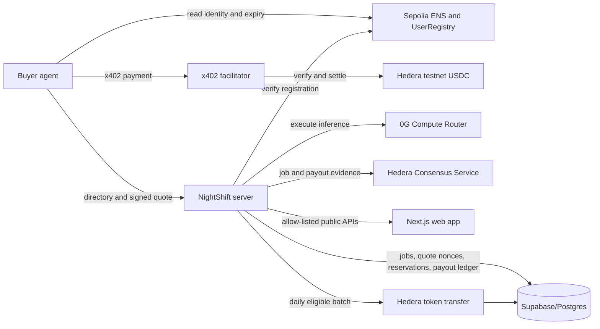

# NightShift release and operations guide

## Release status

This codebase is testnet-oriented. The current source includes signed expiring quotes,
single-use quote redemption, status/settlement APIs, output-digest linkage, and daily payout
processing. It does **not** prove that the deployed server or database has these changes.

Migrations `0004_signed_quotes_and_job_integrity.sql` and
`0005_operations_payouts.sql` are pending external database verification. No live payout,
paid-job, or deployment validation is claimed. An ambiguous Hedera payout remains `uncertain`
and is never automatically resent; an operator must reconcile it against Hedera before releasing
its budget or retrying.

## Architecture



The output digest establishes integrity linkage between the job response, database record, and
HCS message. A hash does **not** establish provider authenticity, model correctness, or TEE
attestation.

## Buyer-to-worker sequence

```mermaid
sequenceDiagram
  participant B as Buyer
  participant S as NightShift API
  participant R as Sepolia Registry
  participant DB as Supabase
  participant F as x402 Facilitator
  participant G as 0G Router
  participant H as Hedera
  B->>S: Discover worker and request quote
  S-->>B: Ed25519 quote (identity, units, amount, asset, network, pay-to, expiry, nonce)
  B->>R: Independently resolve ENS and UserRegistry status/expiry
  B->>S: POST job and signed quote, no payment
  S->>R: Verify current registration at execution boundary
  S->>DB: Atomically reserve budget and check quote redemption
  S-->>B: x402 challenge
  B->>F: Payment-capable retry
  F->>F: Verify exact amount, asset, network and pay-to
  F-->>S: Verified payment
  S->>DB: Claim nonce once; create running job
  S->>G: Execute worker request
  G-->>S: Output and explicit billing metadata
  S->>DB: Store cost, job state and SHA-256 digest
  S->>H: Settle payment and append HCS evidence
  S-->>B: Output, job capability and payment response
  B->>H: Verify transaction and HCS independently
  B->>S: GET /jobs/{id}/status with job capability
  S-->>B: Allow-listed job and settlement fields
```

## Environment variables

Create the repository-root `.env` from `.env.example`. The server validates its required values
at startup. Do not copy secret values into the web app, logs, issues, or chat.

| Variable(s) | Scope and purpose |
|---|---|
| `NODE_ENV`, `PORT` | Server runtime; `PORT` defaults to 8787. |
| `PUBLIC_SERVER_URL`, `PUBLIC_WEB_URL`, `WEB_ORIGIN` | Public URLs used by server configuration and CORS. |
| `SECRETS_MASTER_KEY` | Server-only 32-byte hex AES key; must match the key that encrypted existing agent secrets. |
| `NIGHTSHIFT_QUOTE_SIGNING_PRIVATE_KEY` | Server-only Ed25519 PKCS#8 private key. Never send to buyer/web. |
| `NIGHTSHIFT_QUOTE_VERIFY_PUBLIC_KEY` | Ed25519 SPKI key used by server and buyer to verify signed quotes/capabilities. |
| `ZG_ROUTER_URL`, `ZG_TEAM_SK_KEY`, `ZG_TEAM_MK_KEY`, `ZG_WHISPER_MODEL`, `ZG_CHAT_MODEL` | 0G Router URL, inference secret, optional balance-read secret, and model IDs. `ZG_TEAM_MK_KEY` is optional. |
| `BUYER_ZG_SK_KEY` | Optional buyer rationale key for scripts that use it; not required for deterministic buyer selection. |
| `ZG_TESTNET_ROUTER_URL`, `ZG_TESTNET_SK_KEY`, `ZG_TESTNET_MK_KEY` | Testnet Router spike settings; not used by the production server configuration. |
| `HEDERA_OPERATOR_ID`, `HEDERA_OPERATOR_KEY` | Server Hedera operator; the key pays account-creation/HCS fees. |
| `HEDERA_USDC_TOKEN_ID`, `HEDERA_HCS_TOPIC_ID`, `HEDERA_MIRROR_URL` | Hedera testnet token, HCS topic, and Mirror Node URL. |
| `TREASURY_ACCOUNT_ID` | Hedera treasury account; required server configuration. Current payout policy has a zero fee and sends no treasury transfer. |
| `X402_FACILITATOR_URL` | x402 facilitator URL. |
| `PAYOUTS_ENABLED` | Optional `true`/`false`; defaults to `false`. The scheduled payout processor does not start unless explicitly enabled after deployment approval and database verification. |
| `BUYER_CONSOLE_ENABLED` | Optional `true`/`false` paid demo endpoint gate; defaults to `false`. Enabling requires `PRIVY_APP_ID`, `PRIVY_APP_SECRET`, and `BUYER_CONSOLE_ALLOWED_PRIVY_USER_IDS`. The paid run uses POST and accepts only verified access tokens for allow-listed Privy users. Process-local rate limits remain a multi-instance limitation. |
| `BUYER_CONSOLE_ALLOWED_PRIVY_USER_IDS` | Comma-separated `did:privy:*` IDs permitted to start paid console runs and read the private run event log. Configure server-side only. |
| `BUYER_HEDERA_ACCOUNT_ID`, `BUYER_HEDERA_PRIVATE_KEY`, `BUYER_SERVER_URL` | Buyer testnet account key and target server URL. Never put the key in frontend code. |
| `SEPOLIA_RPC_URL`, `SEPOLIA_LOGS_RPC_URL` | Sepolia read/write RPC and optional event-scan RPC. The log RPC defaults to the primary RPC. |
| `ENS_OPERATOR_PRIVATE_KEY` | Server-only registrar operator key. |
| `DEPLOYER_PRIVATE_KEY`, `ENS_PARENT_NAME`, `ENS_USER_REGISTRY_ADDRESS`, `ENS_HELLO_RESOLVER_ADDRESS`, `ETHERSCAN_API_KEY` | Contract deployment, registrar setup, or verification scripts; not all are used by the running server. |
| `SMOKE_OWNER_PRIVATE_KEY`, `SMOKE_OWNER_ADDRESS`, `SEPOLIA_DRIP_WEI` | Sepolia smoke-test scripts only. |
| `SUPABASE_URL`, `SUPABASE_SERVICE_ROLE_KEY` | Server-only Supabase service-role access. This key bypasses RLS; it must never be exposed to the browser. |
| `SUPABASE_PROJECT_REF`, `SUPABASE_DB_PASSWORD`, `SUPABASE_ACCESS_TOKEN` | Supabase CLI linking/deployment credentials; not server runtime settings. |
| `PRIVY_APP_ID`, `PRIVY_APP_SECRET` | Privy integration settings; secret is server-only. |
| `NEXT_PUBLIC_SERVER_URL` | Public API base URL for the web app. |
| `NEXT_PUBLIC_PRIVY_APP_ID` | Public Privy app ID. |
| `NEXT_PUBLIC_SEPOLIA_RPC_URL` | Browser-side Sepolia read RPC for ENS verification. |
| `NEXT_PUBLIC_ENS_PARENT_NAME`, `NEXT_PUBLIC_NIGHTSHIFT_REGISTRAR_ADDRESS` | Public ENS parent and registrar configuration. |
| `NEXT_PUBLIC_HEDERA_HCS_TOPIC_ID` | Public HCS topic used to form explorer links. |

`HEDERA_NETWORK`, `TREASURY_PRIVATE_KEY`, `SPIKE_*`, and `ENS_*_RESOLVER_ADDRESS` in the
example file support experiments/scripts; do not assume the runtime reads them. The current
server configuration explicitly fixes contract reads to Sepolia and payout transfers to Hedera
testnet.

## Database migrations and access boundaries

Migrations are ordered:

1. `0001_init.sql` — base tables, foreign keys, indexes and initial RLS.
2. `0002_zg_costs_usd_micro.sql` — 0G cost/cap unit correction.
3. `0003_indexer_and_buyer.sql` — directory indexer and buyer event table.
4. `0004_signed_quotes_and_job_integrity.sql` — one-time quote redemptions and output digest.
5. `0005_operations_payouts.sql` — atomic 0G reservations, settlement-recovery queue, payout
   batches/status tracking, and removal of direct anon/authenticated access to agents, jobs,
   payouts, and buyer events.

The web app reads job/activity/event/payout data from server APIs that return allow-listed fields.
Private inputs, outputs, payer details, worker keys, internal errors, and payout destination
accounts must not be added to public response objects.

The server uses Postgres RPCs for atomic budget reservation and payout claiming. When 0G billing
is uncertain after execution, the reservation is expanded to the remaining daily cap and retained
for up to 365 days. Resolve the 0G usage and job record before releasing that reservation through
the service-role `release_agent_budget` RPC. Do not release it simply to unblock work.
Daily budget reads fail closed if any job that could have executed lacks a recorded 0G cost;
explicitly refused-budget jobs are the only costless records excluded from usage. Reconcile
missing usage before resuming that worker.

For an explicitly authorized Supabase deployment:

```powershell
corepack pnpm exec supabase link --project-ref <project-ref>
corepack pnpm exec supabase db push --dry-run
corepack pnpm db:push
corepack pnpm exec supabase migration list
```

Check database backups, the target project, the dry-run output, and RLS before applying. These
commands have **not** been run against the live database in this implementation session.

## Payout operations

- Eligibility is based on settled, unassigned jobs before the UTC payout date.
- The minimum payout is `10,000` USDC atomic units (`0.01 USDC`).
- The current fee is `0` basis points; do not infer a revenue share. The fee is retained as a
  ledger field so a separately approved policy can be added later.
- Daily processing is scheduled for `00:15 UTC`. Each worker/date has a unique payout record and
  jobs are linked to that record in the same database transaction.
- A definite reverted receipt becomes `failed` and may be retried. Any ambiguous submission,
  interruption, or database failure after a transfer becomes `uncertain`; it is never resent
  automatically.
- Payout history is served at `GET /agents/:label/payouts?limit=20&page=1`; it omits destination
  accounts and internal error data.
- The transfer sender is tested only through an injected mock. It has not been called against
  Hedera. Automated tests must never submit a transfer.
- `PAYOUTS_ENABLED` defaults to `false`; when false, the scheduled processor is not registered and
  direct default payout runs return without database access or transfer submission.
- Settlement callback database failures are queued in `settlement_recoveries` and retried with
  bounded backoff. If the primary database is unavailable long enough that the recovery record
  cannot be written either, logs are the only immediate evidence and operator reconciliation is
  required. HCS append failures are logged separately; they do not reverse a settled payment.

## Safe local validation and demo

```powershell
corepack pnpm -r --if-present typecheck
corepack pnpm --filter @nightshift/server test
corepack pnpm --filter @nightshift/buyer test
corepack pnpm --filter @nightshift/web test
corepack pnpm -C scripts demo
corepack pnpm --filter @nightshift/web build
```

The demo command prints a deterministic simulated discovery, quote, x402 flow, result digest,
receipt, HCS item, and payout. Every line is labelled `SIMULATED`; it performs no network request,
does not sign a quote, and creates no transaction, job, or payout record.

Run the read-only buyer preflight only when the required environment is configured:

```powershell
corepack pnpm -C buyer start -- --preflight
```

Preflight does not create a payment-capable request, transfer USDC, launch a worker, or submit a
paid job. Automated tests use mocks. Do not use the paid buyer console or `scripts/pay-run.ts`
for release checks without separately arranging an authorized, low-value test.

## Deployment and release checklist

1. Review the current diff and run all checks listed above; run contract tests only if Foundry and
   the required RPC are available.
2. Provision secrets in the hosting provider; verify quote signing key pair and master-key
   continuity without printing their values.
3. Back up Supabase, run the migration dry-run, then obtain explicit deployment authorization
   before applying migrations 0004 and 0005.
4. Deploy the server and verify `/live`, `/ready`, `/health`, `/directory`, `/a/:label/quote`, and
   `/buyer-console/budget`. Confirm no secret-bearing configuration is returned.
5. Run the buyer read-only preflight and retain its output as evidence. A failed/missing
   configuration item remains `FAIL` or `NOT CONFIGURED`, not a pass.
6. Deploy the web app with public `NEXT_PUBLIC_*` values only. Verify routes and mobile layout
   against deployed API data.
7. Reconcile all `uncertain` jobs and payouts before any paid test. Obtain explicit approval before
   the first transaction; tests and this demo do not submit any.

Known deployed references (verify independently before use):

| Network | Contract/resource | Address |
|---|---|---|
| Sepolia (`11155111`) | NightshiftRegistrar | `0x9564fFd96FBaA1bF10836966990aCc88a9865705` |
| Sepolia (`11155111`) | UserRegistry | `0x68177337D020e03815bE894450914d7C94682425` |
| Hedera testnet | USDC token | `0.0.429274` |
| Hedera testnet | HCS job topic | `0.0.11129931` |

## Troubleshooting

| Symptom | Safe checks |
|---|---|
| `[config] invalid environment` | Configure the named variable in the server environment. Never paste secrets into diagnostics. |
| `/health` is `503` | Check server-side connectivity to 0G, Hedera Mirror Node, Sepolia, and Supabase. Public details are intentionally generic; inspect protected hosting logs. |
| Quote rejected as expired/mismatched | Fetch a fresh quote and verify server/buyer use the corresponding Ed25519 public key. |
| `over_budget` after an interrupted 0G request | Inspect the job, 0G usage, and retained reservation. Do not release it until cost is reconciled. |
| Job paid but database status is incomplete | Match the Hedera transaction and job ID; inspect server logs and database state. Do not retry the paid request. |
| Payout is `uncertain` or `submitted` | Query Hedera/Mirror Node for the exact transfer before manual reconciliation. Never resend automatically. |
| Web history unavailable | Check the server's allow-listed endpoints and migration 0005. Browser Supabase credentials are no longer used for those reads. |
| Contracts test suite cannot run | Install Foundry/submodules and configure Sepolia RPC; do not deploy contracts as a test workaround. |

## Readiness boundary

Mock tests prove application decisions only. Live Sepolia reads, Mirror Node historical reads, and
historical HCS evidence were verified in the prior integration phase; the current signed quote,
database status, payout, and complete end-to-end paths still require deployed migration/config
verification. No live payout or paid job is claimed by this document.
